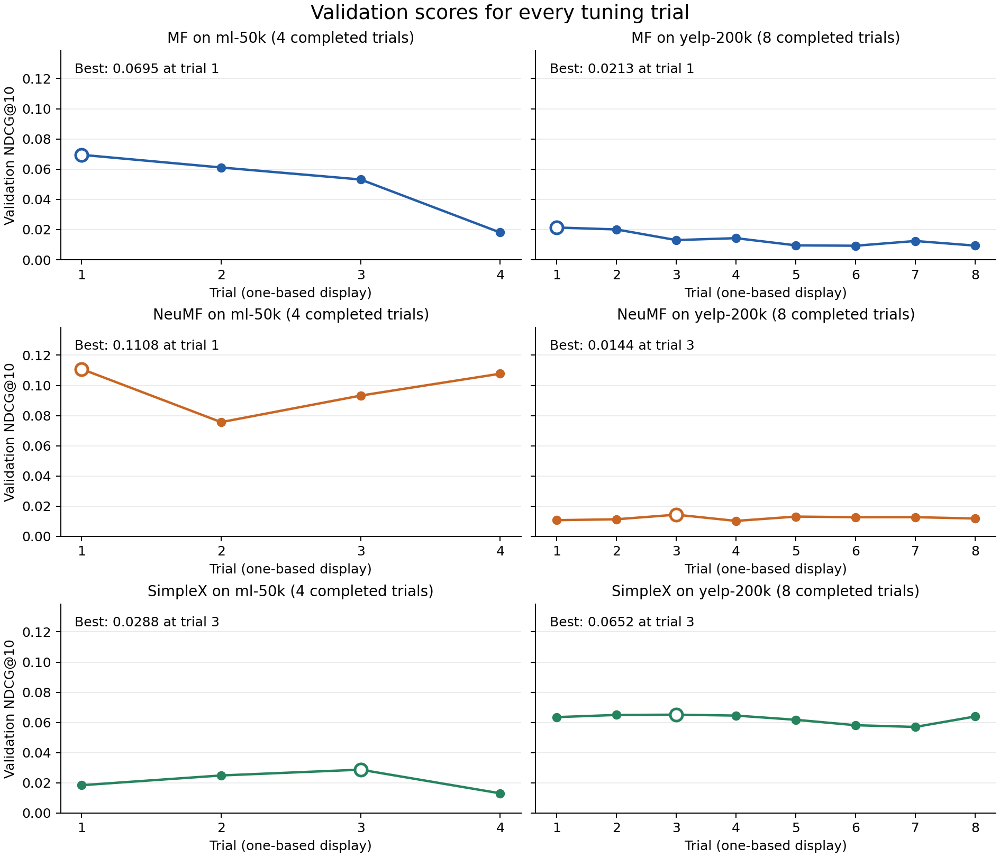
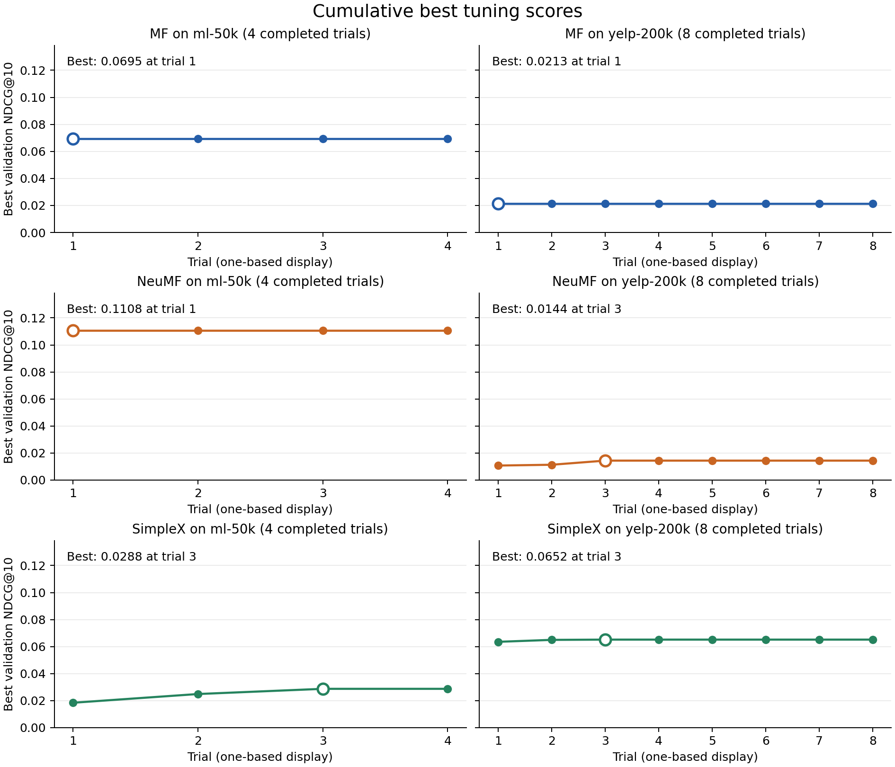

# Verified DaisyRec recommendation experiments

Prepared on 05 October 2026. This report documents the corrected code, supplied datasets, complete tuning evidence and six final tests performed on Ubuntu Linux. Every final training recipe matches its selected configuration and passed the automated audit.

## Purpose and implementation

MF and NeuMF are the baseline models. SimpleX combines a learned user embedding with a projected mean of that user's training-history item embeddings, with a fixed combination weight of 0.5. It scores by cosine similarity and trains with Cosine Contrastive Loss. Its history excludes held-out interactions during fitting. LightGCN retains DaisyRec's normalized bipartite graph propagation; graph construction occurs before model creation and is covered by behavioral checks. [Implementation and verification](IMPLEMENTATION.md) provides the equations, code changes and source references.

## Dataset origin and statistics

MovieLens is a seed-42 sample of [GroupLens MovieLens 1M](https://grouplens.org/datasets/movielens/1m/). A fresh source download reproduced the supplied 50,000-row subset exactly, including row order. Yelp comes from the [provided Kaggle Yelp source](https://www.kaggle.com/datasets/yelp-dataset/yelp-dataset/data), converted to review interactions, sampled to an initial 200,000 rows with seed 42, then filtered once using user/item counts of at least five in that initial sample. The exact historical Yelp release was not recorded. [Dataset documentation](DATASETS.md) distinguishes verified measurements from this recorded preparation procedure.

| Dataset | Raw rows | Users | Items | Processed interactions | Sparsity |
| --- | --- | --- | --- | --- | --- |
| ml-50k | 50,000 | 5,620 | 3,098 | 50,000 | 99.712821% |
| yelp-200k | 88,692 | 13,736 | 12,287 | 87,778 | 99.947991% |

Yelp has 914 duplicate user-item pairs. DaisyRec keeps the last occurrence in file order before sorting by timestamp. All ratings become implicit positives, with no rating threshold or further count filter. Sparsity is `100 * (1 - interactions / (users * items))` after duplicate removal.

## Protocol and environment

Global chronological splitting holds out the latest 20% of processed interactions for test and the latest 10% of the remaining training portion for validation. Tuning therefore fits on approximately 72%, validates on 8% and preserves 20% for test. Final training uses the full 80% after selection. Training histories and graphs are rebuilt from each actual fitting split.

| Dataset | Fitting | Validation | Final training | Test | Test users without training history |
| --- | --- | --- | --- | --- | --- |
| ml-50k | 36000 | 4000 | 40000 | 10000 | 660 |
| yelp-200k | 63201 | 7022 | 70223 | 17555 | 1155 |

Evaluation ranks 1,000 sampled candidates per user, includes ground-truth items, excludes training items from candidate negatives and retains DaisyRec's sampling with replacement. The global time split includes cold users. Results describe this sampled, partly cold-start protocol rather than full-catalog ranking.

The verified environment was Ubuntu 24.04 under WSL2 with Python 3.12.3 and CPU PyTorch 2.5.1, pandas 2.2.3, NumPy 1.26.4, SciPy 1.14.1 and Optuna 4.1.0. Pandas imported successfully on Linux, package checks passed and five behavioral regression checks passed. See [environment metadata](../artifacts/environment.json), [verification output](../artifacts/linux_verification.log) and the [package lock](../artifacts/requirements-linux.lock.txt). Colab setup is documented in the README; Colab was not the recorded execution platform.

## Tuning evidence

All six pairs were freshly tuned using validation NDCG@10, seed 2022, the historical search ranges, four completed trials per model on MovieLens and eight per model on Yelp: 36 completed trials in total. MF uses 20 epochs; NeuMF and SimpleX use 30. Four negatives per positive are retained. The common training settings, fixed parameters and full search spaces are available in `configs/tuning/` and the complete selected recipes.

The configured Optuna TPE sampler has ten startup trials by default. These four/eight-trial studies remain in the random startup phase; the experiments should not be described as completed adaptive Bayesian searches. Their short budgets and single seed limit the strength of model comparisons.

Every trial's validation NDCG, state, parameters and duration is saved in its `trials.csv`, alongside an SQLite study and a complete `trial_configs/` recipe. [Consolidated trial evidence](../artifacts/verified/tuning_trials.csv) and [selected parameters](../artifacts/verified/selected_parameters.csv) retain the numerical values at full precision. Plot trial labels are one-based, while saved Optuna trial IDs are zero-based.





| Model | Dataset | Selected trial ID | Validation NDCG@10 | Factors | Batch | Learning rate | L1 | L2 | Epochs |
| --- | --- | --- | --- | --- | --- | --- | --- | --- | --- |
| MF | ml-50k | 0 | 0.069478 | 32 | 1024 | 0.021 | 0.001 | 0.0 | 20 |
| MF | yelp-200k | 0 | 0.021346 | 32 | 1024 | 0.021 | 0.001 | 0.0 | 20 |
| NeuMF | ml-50k | 0 | 0.110827 | 16 | 256 | 0.005000000000000001 | 0.009000000000000001 | 0.007 | 30 |
| NeuMF | yelp-200k | 2 | 0.014400 | 48 | 512 | 0.003 | 0.009000000000000001 | 0.004 | 30 |
| SimpleX | ml-50k | 2 | 0.028761 | 64 | 512 | 0.008 | 0 | 0 | 30 |
| SimpleX | yelp-200k | 2 | 0.065171 | 32 | 256 | 0.0055 | 0 | 0 | 30 |

| Model | Dataset | Layers | Dropout | Margin | Negative weight | Gamma |
| --- | --- | --- | --- | --- | --- | --- |
| NeuMF | ml-50k | 3 | 0.2 | - | - | - |
| NeuMF | yelp-200k | 2 | 0.30000000000000004 | - | - | - |
| SimpleX | ml-50k | - | 0.2 | 0.9 | 20 | 0.5 |
| SimpleX | yelp-200k | - | 0.3 | 0.5 | 10 | 0.5 |

## Final tests

The six final tests load their complete selected training recipes. Common reporting metrics are saved for all pairs. The audit checks selected settings, completed trial budgets, source/data hashes and Linux provenance. [Audit evidence](../artifacts/verified/audit.json) and [the full result table](../artifacts/verified/final_summary.csv) make these checks reviewable.

### ml-50k

| Model | Recall@10 | NDCG@10 | MRR@10 | Hit@10 | Precision@10 | Coverage@10 | Gini@10 | Entropy@10 |
| --- | --- | --- | --- | --- | --- | --- | --- | --- |
| MF | 0.035169 | 0.086964 | 0.069236 | 0.167724 | 0.020085 | 0.501291 | 0.624515 | 9.480393 |
| NeuMF | 0.052317 | 0.120102 | 0.096818 | 0.232558 | 0.028118 | 0.330213 | 0.779789 | 7.777818 |
| SimpleX | 0.014315 | 0.040691 | 0.030165 | 0.082452 | 0.009302 | 0.544868 | 0.682069 | 9.401766 |

In this run, NeuMF has the highest test NDCG@10 (0.120102), followed by MF (0.086964) and SimpleX (0.040691). These are single-seed measurements; no statistical significance claim is supported.

| Model | Result file |
| --- | --- |
| MF | [mf_kpi_results.csv](../artifacts/verified/results/ml-50k/mf_kpi_results.csv) |
| NeuMF | [neumf_kpi_results.csv](../artifacts/verified/results/ml-50k/neumf_kpi_results.csv) |
| SimpleX | [simplex_kpi_results.csv](../artifacts/verified/results/ml-50k/simplex_kpi_results.csv) |

### yelp-200k

| Model | Recall@10 | NDCG@10 | MRR@10 | Hit@10 | Precision@10 | Coverage@10 | Gini@10 | Entropy@10 |
| --- | --- | --- | --- | --- | --- | --- | --- | --- |
| MF | 0.024750 | 0.032882 | 0.024423 | 0.065097 | 0.007094 | 0.431676 | 0.576226 | 11.534518 |
| NeuMF | 0.014223 | 0.018919 | 0.012614 | 0.041558 | 0.004334 | 0.686091 | 0.589931 | 11.927237 |
| SimpleX | 0.082562 | 0.082864 | 0.061718 | 0.170779 | 0.020276 | 0.925206 | 0.436702 | 13.012332 |

In this run, SimpleX has the highest test NDCG@10 (0.082864), followed by MF (0.032882) and NeuMF (0.018919). These are single-seed measurements; no statistical significance claim is supported.

| Model | Result file |
| --- | --- |
| MF | [mf_kpi_results.csv](../artifacts/verified/results/yelp-200k/mf_kpi_results.csv) |
| NeuMF | [neumf_kpi_results.csv](../artifacts/verified/results/yelp-200k/neumf_kpi_results.csv) |
| SimpleX | [simplex_kpi_results.csv](../artifacts/verified/results/yelp-200k/simplex_kpi_results.csv) |

## Interpretation and limits

Coverage is the fraction of catalog items appearing in recommendations. Entropy is the exposure-distribution entropy in bits. The retained Gini implementation uses only items that received at least one recommendation, excluding zero-exposure catalog items. Coverage, Gini and entropy therefore measure different aspects of exposure; none alone establishes fairness, user satisfaction or within-list diversity. Higher Gini indicates more concentration within the covered item set.

No repeated-seed uncertainty interval or history ablation was run. The comparisons support the measured outcomes under this protocol, but cannot establish that a particular architecture component caused an improvement. The sparse datasets, cold users, sampled candidates, short startup-phase searches and limited negative budget all constrain generalization.

The original report and historical outputs contain inconsistencies: the Yelp label and final interaction count were inaccurate, no-filter wording omitted preparation filtering, SimpleX's actual objective was CCL, the legacy tuning cutoff was 50 rather than 10, and Yelp SimpleX testing used margin 0.9 rather than the selected 0.7. Later historical logs already contained an eight-trial completion, following earlier interrupted runs. Historical trial-level scores were not fully retained; fresh studies provide the requested complete evidence. The legacy files are preserved under `artifacts/legacy/`.

## Run commands

From the activated Linux environment in the project root:

```bash
python scripts/run_experiments.py --stage all --jobs 2
```

To repeat only the six final tests with their selected configurations:

```bash
python scripts/run_experiments.py --stage test --jobs 2
```

The [README](../README.md) provides setup, dataset preparation, Colab and PowerShell-to-WSL commands.
